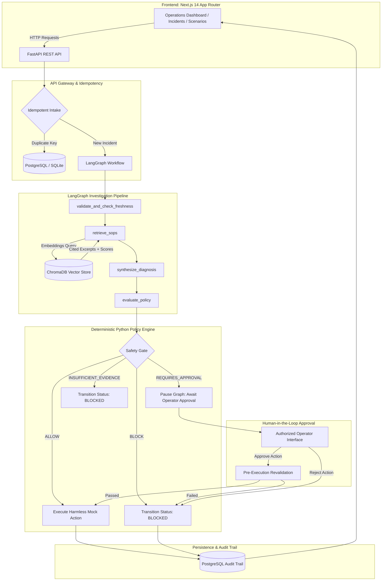

# FleetOps AI — Agentic Drone Incident Investigation & Safe Response

[](backend/README.md)
[](frontend/README.md)
[](frontend/README.md)
[](backend/README.md)
[](backend/README.md)
[](backend/README.md)
[](docker-compose.yml)

A full-stack, production-minded demonstration of **Agentic AI Engineering** for autonomous drone operations. When an industrial drone operation fails or triggers a perimeter alarm, FleetOps AI investigates simulated telemetry, mission history, and chunked Standard Operating Procedures (SOPs). It synthesizes an evidence-backed diagnosis, explicitly marks uncertainty, and recommends a response plan that must pass through an independent, deterministic Python safety gate before execution.

---

## 1. Problem Statement

Industrial drone fleets face diverse failure signals: rapid battery discharge, telemetry packet loss, optical gimbal lock, geofence perimeter violations, and adverse weather alarms. Operators must rapidly correlate telemetry streams, device health logs, and complex operating manuals before taking corrective flight actions.

**Core Problem Statement:**
> *"Given a simulated drone incident, investigate available evidence, identify the most likely explanation, cite supporting records and procedures, and recommend a safe next step without allowing an LLM to bypass flight safety rules."*

---

## 2. Why FleetOps AI is Different

Most AI agent demonstrations rely on the LLM to decide whether a flight action is safe. In mission-critical aviation, this approach is fundamentally unacceptable.

FleetOps AI is engineered on the principle:
> **"The AI Proposes and Explains; Deterministic Code Validates and Enforces."**

| Capability | What We Demonstrate | Why It Matters |
|---|---|---|
| **Evidence-Backed Diagnosis** | Links conclusions to observable telemetry and cited SOP chunks; separates facts from hypotheses. | Reviewers and operators inspect exactly why a conclusion was formulated. |
| **Deterministic Safety Gate** | Pure Python policy checks geofences, battery reserve thresholds, telemetry age, and permissions independently of LLM. | An LLM response cannot authorize an unsafe flight command. |
| **Stateful Human-in-the-Loop** | LangGraph persistent workflow state pauses when human approval is required and resumes safely upon authorization. | Real orchestration beyond single prompts. |
| **Idempotency & Double-Execution Guard** | Intake webhook deduplication and unique action execution keys. | Prevents double dispatch or duplicate commands. |
| **Failure-Oriented Evaluation** | 9 repeatable evaluation scenarios covering stale data, tool timeouts, geofence breaches, and unauthorized operators. | Proves resilience and reliability under real-world operational edge cases. |

---

## 3. Architecture & Data Flow



---

## 4. Technology Stack

- **Frontend**: Next.js 14 (App Router), TypeScript (Strict), Tailwind CSS, Lucide React, Vitest.
- **Backend API**: Python 3.12/3.11, FastAPI, Pydantic v2 (Settings & BaseModels), SQLAlchemy 2.0 (asyncio).
- **Agentic Workflow**: LangGraph (`StateGraph`), persistent `MemorySaver` checkpointer.
- **RAG & Vector Retrieval**: ChromaDB, 384-dimensional deterministic normalized vector feature hashing (offline) / OpenAI embeddings (configurable).
- **Persistence**: Dual async engine support for PostgreSQL (production & Docker) and SQLite (zero-config local dev & tests).
- **Containerization**: Separate Docker Compose stack (host port 5434 for postgres, 8000 for backend, 3000 for frontend).

---

## 5. Repository Structure

```
fleetops-ai/
├── frontend/
│   ├── app/                # Next.js 14 App Router pages (Dashboard, Incidents, Scenarios)
│   ├── components/         # Status badges, navbar, evidence cards
│   ├── lib/                # Typed API client (lib/api.ts) & TypeScript models (lib/types.ts)
│   ├── tests/              # Vitest frontend unit tests
│   ├── .env.example        # Frontend environment template
│   ├── package.json        # Node.js dependencies & scripts
│   └── README.md           # Standalone Frontend documentation
├── backend/
│   ├── app/
│   │   ├── api/v1/         # FastAPI REST routers (incidents, scenarios, dashboard, health)
│   │   ├── core/           # Configuration & async SQLAlchemy database session
│   │   ├── schemas/        # Pydantic v2 schemas
│   │   ├── models/         # SQLAlchemy 2.0 entities (incidents, investigations, approvals, audit)
│   │   ├── services/       # Incident orchestration & scenario catalog
│   │   ├── agents/         # LangGraph state graph & prompt templates
│   │   ├── retrieval/      # ChromaDB retriever & SOP ingestion
│   │   ├── policies/       # Deterministic Python safety gate
│   │   ├── tools/          # Harmless simulated drone action executor
│   │   ├── db/             # Database seeding
│   │   └── main.py         # FastAPI application entrypoint
│   ├── tests/              # Pytest test suite (unit, integration, scenarios)
│   ├── data/
│   │   ├── sops/           # Synthetic Standard Operating Procedures (.md)
│   │   └── scenarios/      # Scenario fixtures
│   ├── alembic/            # Database migrations
│   ├── .env.example        # Backend environment template
│   ├── pyproject.toml      # Python dependencies
│   └── README.md           # Standalone Backend documentation
├── docs/
│   ├── architecture.md     # Detailed architecture & component boundaries
│   ├── api-examples.md     # Request/response curl examples
│   └── decisions.md        # Architecture Decision Records (ADRs)
├── docker-compose.yml      # Dedicated Docker Compose stack
├── .gitignore
└── README.md               # Root Project Documentation
```

---

## 6. Getting Started

### Prerequisites
- **Python**: 3.11+ (Python 3.12 recommended)
- **Node.js**: 20.x+ and npm 10.x+
- **Docker & Docker Compose** (Optional, for containerized run)

---

### Option A: Local Development (Fastest, Zero External Dependencies)

#### Step 1: Backend Setup
```bash
cd backend

# Create virtual environment
python3 -m venv .venv
source .venv/bin/activate

# Install dependencies using uv or pip
pip install -e ".[dev]"

# Configure environment
cp .env.example .env

# Run database migrations
alembic upgrade head

# Ingest SOP procedures into ChromaDB
python -m app.retrieval.ingest

# Seed initial demonstration incidents
python -m app.db.seed

# Start FastAPI server
uvicorn app.main:app --host 0.0.0.0 --port 8000 --reload
```
*Backend is now running at `http://localhost:8000` (Swagger UI at `/docs`).*

#### Step 2: Frontend Setup
In a new terminal:
```bash
cd frontend

# Install dependencies
npm install

# Configure environment
cp .env.example .env.local

# Start Next.js development server
npm run dev
```
*Frontend is now running at `http://localhost:3000`.*

---

### Option B: Docker Compose (Dedicated, Separate Stack)

FleetOps AI provides a dedicated `docker-compose.yml` that creates isolated containers without interfering with existing host services:
- Dedicated PostgreSQL 16 container (host port `5434:5432`)
- Backend FastAPI container (host port `8000:8000`)
- Frontend Next.js container (host port `3000:3000`)

```bash
# Configure root environment
cp .env.example .env

# Build and start all services
docker compose up --build -d

# Check service health
docker compose ps
```

---

## 7. Repeatable Scenario Suite (9 Mandatory Scenarios)

FleetOps AI implements the 9 failure-oriented evaluation scenarios specified in the blueprint. Run them from the UI (`/scenarios`) or via automated tests:

| Scenario | Initial Conditions | Expected Safety Gate | Expected Status | What It Verifies |
|---|---|---|---|---|
| **1. Low Battery** | Battery at 18.0%, severity HIGH, proposed backup dispatch. | `BLOCK` (`POL-BATTERY-01`) | `BLOCKED` | Minimum 30% reserve policy strictly enforced. |
| **2. Stale Telemetry** | Telemetry timestamp is 300s old (> 60s max threshold). | `ALLOW` (refresh only) | `RESOLVED` | Flight maneuvers prohibited; telemetry refresh issued. |
| **3. Duplicate Webhook** | Ingestion webhook with identical `idempotency_key`. | Idempotent | `RESOLVED` | Returns existing incident; zero duplicate actions. |
| **4. No Relevant SOP** | Unknown anomaly event type; 0 ChromaDB citations. | `INSUFFICIENT_EVIDENCE` | `BLOCKED` | RAG grounding check prevents procedural hallucinations. |
| **5. Conflicting SOPs** | High wind perimeter breach triggers conflicting SOP-005. | `REQUIRES_APPROVAL` | `AWAITING_APPROVAL` | Workflow pauses; mandates flight supervisor review. |
| **6. Unauthorized Operator**| Attempting approval with role `viewer`. | Rejected (HTTP 403) | `FORBIDDEN` | Backend authorization rejects unauthorized roles. |
| **7. Tool Timeout** | Simulated telemetry API timeout during execution. | Error Handled | `ERROR` | Workflow state preserved; failure recorded in audit log. |
| **8. Geofence Violation**| Waypoint coordinates outside Site Alpha bounding box. | `BLOCK` (`POL-GEOFENCE-01`) | `BLOCKED` | Strict boundary containment enforced. |
| **9. Normal Patrol Fault**| Optical camera gimbal error, battery 72%, fresh data. | `ALLOW` | `RESOLVED` | Evidence-backed diagnosis & compliant diagnostic hover. |

---

## 8. Automated Verification & Test Results

### Backend Test Suite (Pytest)
```bash
cd backend
source .venv/bin/activate
pytest -v
```
**Actual Test Results:**
```
======================== 23 passed, 1 warning in 2.26s =========================
- tests/integration/test_api_endpoints.py::test_health_and_ready_endpoints PASSED
- tests/integration/test_api_endpoints.py::test_incident_intake_idempotency PASSED
- tests/integration/test_api_endpoints.py::test_investigation_and_approval_workflow PASSED
- tests/scenarios/test_all_scenarios.py::test_scenario_catalog_endpoint PASSED
- tests/scenarios/test_all_scenarios.py::test_run_each_scenario_end_to_end[low_battery] PASSED
- tests/scenarios/test_all_scenarios.py::test_run_each_scenario_end_to_end[stale_telemetry] PASSED
- tests/scenarios/test_all_scenarios.py::test_run_each_scenario_end_to_end[duplicate_webhook] PASSED
- tests/scenarios/test_all_scenarios.py::test_run_each_scenario_end_to_end[no_relevant_sop] PASSED
- tests/scenarios/test_all_scenarios.py::test_run_each_scenario_end_to_end[conflicting_sops] PASSED
- tests/scenarios/test_all_scenarios.py::test_run_each_scenario_end_to_end[unauthorized_operator] PASSED
- tests/scenarios/test_all_scenarios.py::test_run_each_scenario_end_to_end[tool_timeout] PASSED
- tests/scenarios/test_all_scenarios.py::test_run_each_scenario_end_to_end[geofence_violation] PASSED
- tests/scenarios/test_all_scenarios.py::test_run_each_scenario_end_to_end[normal_patrol_failure] PASSED
- tests/unit/test_policy_rules.py (7 policy unit tests) PASSED
- tests/unit/test_retrieval.py (3 RAG citations unit tests) PASSED
```

### Frontend Test Suite (Vitest) & Build
```bash
cd frontend
npm test
npm run build
```
**Actual Test & Build Results:**
```
✓ tests/api_and_badges.test.ts (2 passed)
✓ Next.js compiled successfully
✓ Linting and type checking: 0 errors
✓ Static and dynamic pages generated: 6/6
```

---

## 9. Security & Simulation Disclaimer

> [!IMPORTANT]
> **SIMULATED DEMONSTRATION DISCLAIMER**:
> FleetOps AI is an independent software-engineering portfolio project demonstrating agentic reasoning, RAG grounding, and deterministic safety policy gating.
> - **Zero Physical Flight Commands**: All drone telemetry and actions interact strictly with an internal simulation boundary (`app/tools/mock_action_api.py`).
> - **No Hardware Control**: No physical drone hardware, flight controller (PX4/ArduPilot), or live flight actuation is connected.
> - **Aviation Safety**: Zero unsafe executions in a synthetic scenario suite does not constitute proof of real-world flight safety. Deployment in actual industrial drone operations requires certified avionics hardware, FAA/EASA regulatory compliance, and redundant physical failsafes.
