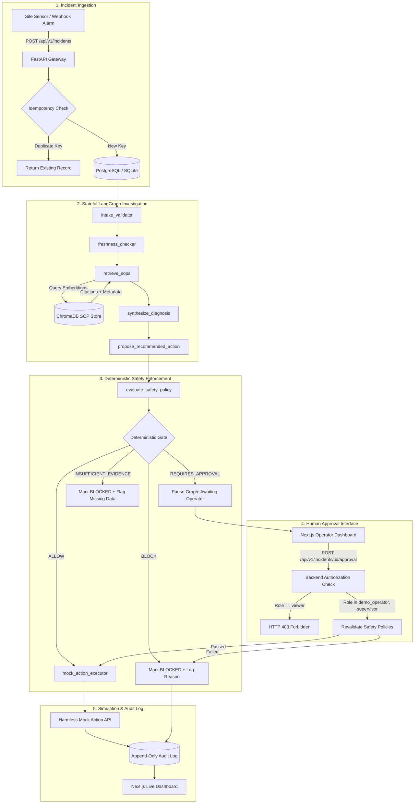
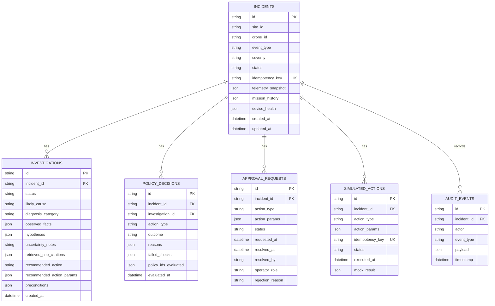

# FleetOps AI Architecture & System Design

FleetOps AI is a production-grade, simulated agentic drone incident investigation and deterministic safe response platform.

## 1. System Overview & Core Philosophy

In industrial and autonomous drone operations, incidents require rapid analysis across heterogeneous streams: telemetry heartbeats, hardware diagnostic logs, mission logs, and standard operating procedures (SOPs).

A core engineering principle guides FleetOps AI:
> **"The AI Proposes and Explains; Deterministic Code Validates and Enforces."**

Large Language Models (LLMs) and agentic workflows excel at correlating unstructured evidence and identifying potential explanations. However, in safety-critical aviation domains, an LLM must **never** be the sovereign authority executing flight commands. FleetOps AI enforces an independent, deterministic Python safety gate that intercepts every proposed action and evaluates hard constraints (geofence polygons, battery reserve thresholds, telemetry age limits, and operator permissions) before any simulated action can execute.

---

## 2. Component Boundaries

### A. Frontend Layer (Next.js 14 App Router)
- **Role**: Operator UI, telemetry visualization, incident triage, and human approval portal.
- **Tech**: Next.js 14, React 18, TypeScript, Tailwind CSS, Lucide icons.
- **Boundary**: Communicates strictly with the FastAPI REST API via typed HTTP client (`lib/api.ts`). No backend logic or database access occurs in Next.js routes.

### B. API Gateway & Orchestration (FastAPI + LangGraph)
- **Role**: Endpoint routing, request validation via Pydantic v2, asynchronous workflow orchestration.
- **Tech**: FastAPI, Pydantic, LangGraph StateGraph, MemorySaver checkpointer.
- **Boundary**: Coordinates data loading, triggers graph transitions, and manages persistent incident states.

### C. RAG Vector Retrieval Store (ChromaDB)
- **Role**: Semantic procedure chunk storage and retrieval with source citations.
- **Tech**: ChromaDB PersistentClient, Deterministic Drone SOP Embedding Function (384-dimensional normalized vector hashing with cosine similarity).
- **Boundary**: Provides grounded procedure excerpts (`SOP-001` through `SOP-005`). Returns empty citations when no procedure exists, preventing LLM hallucination.

### D. Deterministic Safety Gate (`app/policies/rules.py`)
- **Role**: Pure Python validation gate completely decoupled from LLMs.
- **Tech**: Deterministic rule engine evaluating:
  1. `POL-ALLOWLIST-01`: Action in harmless allowlist.
  2. `POL-BATTERY-01`: Minimum 30% battery for dispatch.
  3. `POL-FRESHNESS-01`: Maximum 60s telemetry age.
  4. `POL-GEOFENCE-01`: Containment within Site Alpha operational bounding box.
  5. `POL-RAG-01`: Mandatory procedure evidence grounding.
  6. `POL-CONFLICT-01`: Mandatory supervisor escalation on contradictory SOPs.
  7. `POL-AUTH-01`: Role-based access control (`viewer` role rejected with 403).
  8. `POL-APPROVAL-01`: Mandatory operator authorization on high-consequence dispatches.

### E. Persistence Layer (PostgreSQL & SQLite)
- **Role**: Relational storage for incidents, investigation findings, policy decisions, approvals, and audit events.
- **Tech**: SQLAlchemy 2.0 (asyncio with `asyncpg` and `aiosqlite`), Alembic migrations.

---

## 3. Data Schema & Relationships

